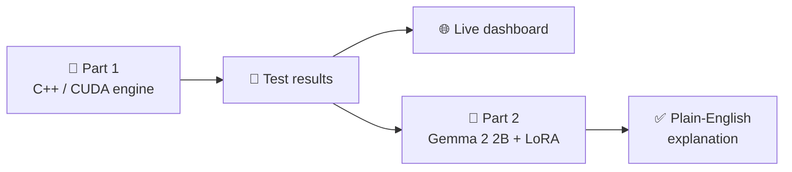
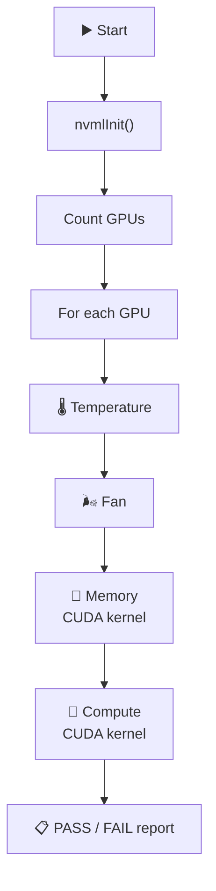
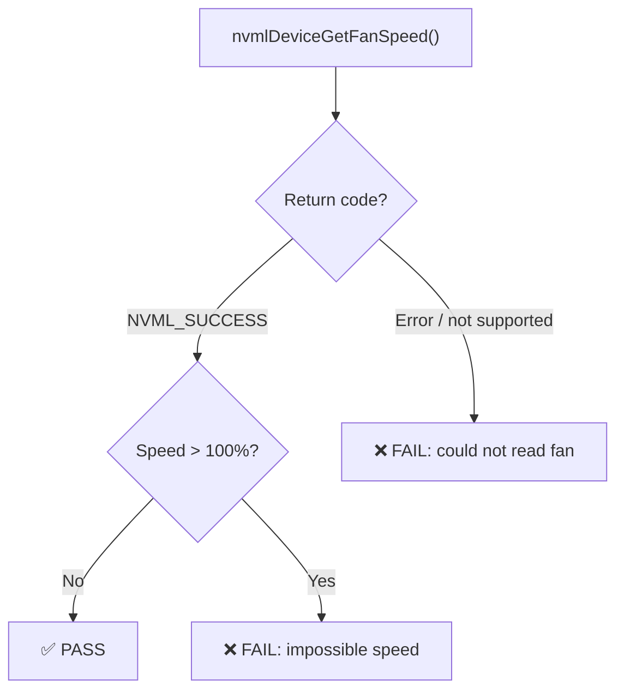
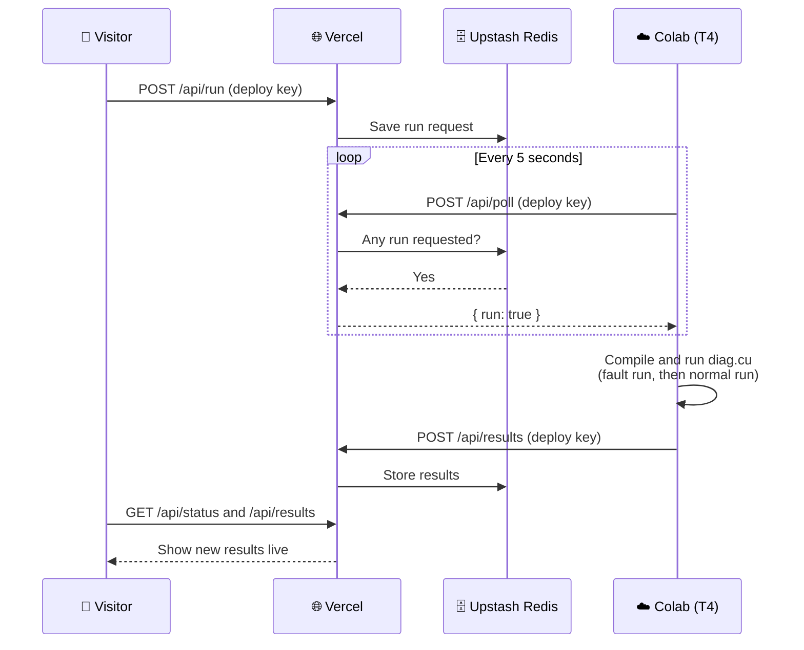
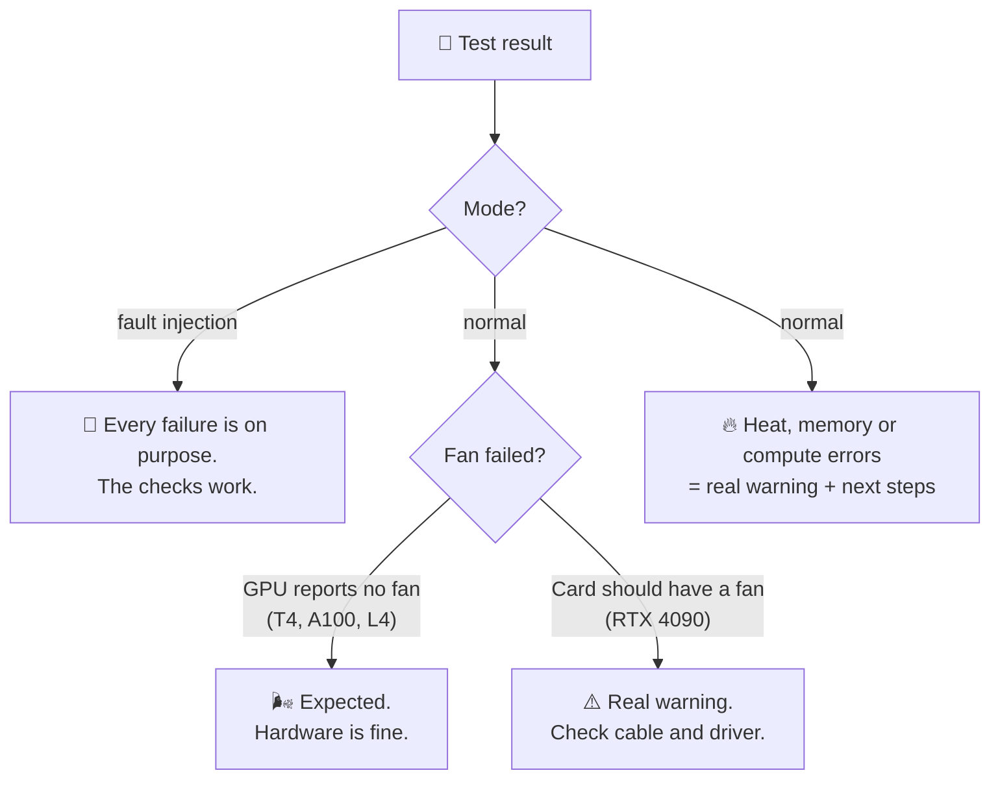
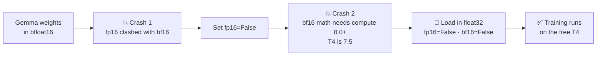

<div align="center">

# GPU Diagnostics Test Suite

**A live hardware integrity monitor for a C++/CUDA GPU diagnostics test suite, with a fine-tuned AI model that explains the results.**


[🌐 Live Dashboard](https://gpu-diagnostic.vercel.app/) · [🤗 AI Model](https://huggingface.co/williammahunda/gemma-2-2b-it-gpu-diag-lora) · [👤 Portfolio](https://william-frank-mahunda.vercel.app/) · [💼 LinkedIn](https://www.linkedin.com/in/william-frank-mahunda)

<br>


</div>

<br>

A real NVIDIA GPU, in Colab, runs a diagnostic engine written in C++ and CUDA. It checks temperature and fan speed through NVML, torture-tests a million values of GPU memory, and verifies a million GPU compute results against the CPU. Then it can deliberately break every one of those checks on purpose, to prove each one actually catches the failure it claims to catch. This page shows the results live, can ask Colab to run it all again, and a fine-tuned AI model explains what each result means.

> **Part 1 finds the problems. Part 2 explains them.**



# 🔧 Part 1: Diagnostic Engine

## What it checks

| Check | What it does |
|---|---|
| **GPU temperature** | Reads the core temperature through NVML and compares it with an 85 °C limit. |
| **Fan speed** | Reads the fan speed through NVML. Fails if the fan can't be read, or if the value is above 100%. |
| **Memory pattern test** | Writes four bit patterns into 1,000,000 values of GPU memory, then reads every value back. |
| **Compute check** | Adds 1,000,000 pairs of numbers on the GPU and checks every answer on the CPU. |
| **Fault injection** | Deliberately corrupts the run above, so you can see that every check actually fails when it should. |



## Fault injection: proving the checks work

A test that always passes proves nothing. So the engine has a fault injection mode that plants errors on purpose. If a check still passes, the check is broken.

| Check | Fault injected | Expected result |
|---|---|---|
| 🌡️ Temperature | Limit lowered to 10 °C | ❌ FAIL |
| 🌬️ Fan | Speed set to an impossible 150% | ❌ FAIL |
| 💾 Memory | One value corrupted in each of the 4 patterns | ❌ FAIL (4 wrong values) |
| 🧮 Compute | One answer changed to a wrong value | ❌ FAIL (1 wrong answer) |

<div align="center">

<br><sub>Fault injection on. Every check correctly fails, and the corrupted cell lights up red in the memory map.</sub>
</div>

## 🌬️ The fan story: an honest failure

The free Colab GPU is a **Tesla T4**, a passively cooled server card with **no fan of its own**. The server cools it.

**The bug I found:** the first version of the fan test **passed** on the T4. NVML couldn't read a fan, so the speed stayed at its starting value of 0, and 0 is not above 100, so the check said PASS. It was checking a number that was never really read.

**The fix:** the test now checks NVML's return code before it trusts the value. If the fan can't be read, the test fails honestly:

```text
ERROR: could not read fan speed (this GPU may have no fan)
[fan] FAIL
```

So on a healthy T4, the dashboard shows **1 of 4 checks failed**. That red result is on purpose: the tool only reports what it can actually measure, and Part 2's AI model explains that this failure is expected.



## Under the hood: where software touches hardware

This dashboard is the thin, pretty layer on top. The real work is [`engine/diag.cu`](engine/diag.cu): C++ and CUDA that talk to the GPU directly, not through a simulation or a mocked sensor.

**NVML crosses into the driver.** `nvmlDeviceGetTemperature` and `nvmlDeviceGetFanSpeed` aren't reading a config file. They ask NVIDIA's management library to go through the driver and return what the die's thermal sensor and the board's fan tachometer are reporting right now. Each call's return code is checked before the value is trusted:

```cpp
nvmlReturn_t result = nvmlDeviceGetTemperature(gpu, NVML_TEMPERATURE_GPU, &temp);
if (result != NVML_SUCCESS) return false;   // no reading means no pass

nvmlReturn_t fanResult = nvmlDeviceGetFanSpeed(gpu, &speed);
if (fanResult != NVML_SUCCESS) return false; // fan could not be read
```

**CUDA kernels run on physical cores.** `__global__` marks a function that's compiled to the GPU's own instruction set and launched across thousands of its cores at once. This isn't a CPU `for` loop, it's silicon:

```cpp
__global__ void fillMemory(unsigned int* data, int n, unsigned int pattern) {
    int i = blockIdx.x * blockDim.x + threadIdx.x;   // which thread am I?
    if (i < n) data[i] = pattern;
}
```

```cpp
fillMemory<<<(n + 255) / 256, 256>>>(data, n, pattern);
```

This launches roughly 4,000 blocks of 256 threads: one real core touching one real memory cell, a million times over, four bit patterns in a row.

**`cudaMallocManaged` allocates real VRAM.** The memory and compute tests work on unified memory that physically lives on the GPU's own memory chips, made addressable from the CPU too.

Flip `injectFault` to `true` and every one of those same hardware paths runs again with a deliberately wrong expectation: the limit drops to 10 °C, a fan reading jumps to 150%, and one value out of a million gets corrupted in VRAM. You can watch each check go from PASS to FAIL for the right reason, on the actual hardware.

## Architecture


Three pieces, one direction of trust: **Colab only ever calls out** to the website. It never opens a port, needs a tunnel, or exposes a public address.



1. **Colab notebook** compiles and runs `diag.cu` against a real GPU, then polls `/api/poll` every 5 seconds to ask "has someone requested a run?"
2. If the website answers `{ run: true }`, Colab runs the diagnostics and `POST`s the results to `/api/results`.
3. **Vercel** hosts this static page plus four serverless functions, and is the only thing that talks to storage.
4. **Upstash Redis** (free tier, attached via Vercel Storage) holds the latest `results` and `status` as JSON, nothing else.
5. Your **browser** polls `/api/status` and `/api/results` (public, read-only) to keep the page live, and can `POST /api/run` to ask for a fresh run, which requires the deploy key.

# 🧠 Part 2: AI Explainer

## Why

Raw output like `[fan] FAIL` doesn't say whether something is really wrong. A plain AI model sees that failure and worries. So I fine-tuned **Google's Gemma 2 2B** with **LoRA** to read this tool's output and explain each result in plain English.

🤗 **Model:** [williammahunda/gemma-2-2b-it-gpu-diag-lora](https://huggingface.co/williammahunda/gemma-2-2b-it-gpu-diag-lora)

## How the AI gets its input

The Colab control panel builds the model's input automatically with `make_model_input()`, adding five header lines so real results look exactly like the training examples:

```text
GPU: Tesla T4
Memory: 15360 MiB
Driver: 580.82.07
Fan: none (GPU reports no fan)
Mode: normal
```

The **Fan** line comes from asking the GPU itself with `nvidia-smi --query-gpu=fan.speed`. If it reports `N/A`, the GPU has no fan. This works on any NVIDIA GPU, with no hard-coded list of models.

## What the model learned



## Before vs after

| 😕 Plain Gemma | ✅ Fine-tuned Gemma |
|---|---|
| A long, unsure answer that called the fan failure *"a bit concerning"*, told the user to go check for a fan, and got cut off mid-sentence. | **1 of 4 checks failed.**<br>• Temperature passed. 47 C is a safe level.<br>• Fan failed, but this is expected. The NVIDIA L4 reports no fan, because it is cooled by the server. The hardware is fine.<br>• Memory passed.<br>• Compute passed. |

> 🎯 The fine-tuned answer matched the expected answer word for word.

## Training at a glance

| | |
|---|---|
| 🤖 **Base model** | google/gemma-2-2b-it (4-bit NF4) |
| 🧩 **Method** | LoRA via Hugging Face PEFT + TRL SFTTrainer |
| ⚙️ **LoRA settings** | r=16 · alpha=32 · dropout=0.05 · all linear layers |
| 📚 **Data** | 360 train + 40 test synthetic examples across 6 GPUs |
| 🖥️ **GPUs covered** | Tesla T4 · A100 · L4 · RTX 3090 · RTX 4090 · RTX A4000 |
| 🔁 **Training** | 2 epochs · lr 2e-4 · batch 2 × 4 grad accumulation |
| 💻 **Hardware** | Free Tesla T4 on Google Colab |
| ⏱️ **Time** | ~12 minutes |
| 📉 **Loss** | 1.15 ➜ 0.19 |

## Challenge I solved: bfloat16 on a T4



Gemma's weights come in **bfloat16**, a format the Tesla T4 can't use for training. The trainer even switched bfloat16 back on by itself when fp16 was off. I loaded the model in **float32** and turned off both fp16 and bf16 by hand. It uses a bit more memory, but it fits on the T4.

> **The lesson:** the same code can work on one GPU and fail on another. Match the number format to the hardware.

# 🗺️ Roadmap: more NVML checks

The four checks above only use two calls out of the dozens NVIDIA exposes in [NVML's Device Queries API](https://docs.nvidia.com/deploy/nvml-api/api/group__nvmlDeviceQueries.html). Here's what's planned next:

| Planned check | NVML call | What it would catch |
|---|---|---|
| **Power draw** | `nvmlDeviceGetPowerUsage` | Is the card pulling more power than its own limit (`nvmlDeviceGetPowerManagementLimit`) allows? |
| **Clock speed** | `nvmlDeviceGetClockInfo` | Is the GPU running near its rated clock, or quietly throttled below `nvmlDeviceGetMaxClockInfo`? |
| **Why it's throttled** | `nvmlDeviceGetCurrentClocksThrottleReasons` | If it is slow, why: too hot, power-capped, or something else. |
| **Utilization** | `nvmlDeviceGetUtilizationRates` | Was the GPU actually busy during a test? |
| **VRAM usage** | `nvmlDeviceGetMemoryInfo` | Used, free and total memory. Catches leaks and cards reporting less VRAM than expected. |
| **ECC memory errors** | `nvmlDeviceGetTotalEccErrors` | Corrected and uncorrected memory errors the driver already caught. |
| **Remapped memory rows** | `nvmlDeviceGetRemappedRows` | Whether failing VRAM cells were swapped out behind the scenes, a sign a card is wearing out. |
| **PCIe link health** | `nvmlDeviceGetCurrPcieLinkGeneration` + `nvmlDeviceGetCurrPcieLinkWidth` | Whether the card runs at its rated PCIe generation and width, or got silently downgraded. |
| **Temperature limit, per GPU** | `nvmlDeviceGetTemperatureThreshold` | The card's own slowdown threshold, instead of 85 °C for every model. |
| **Performance state** | `nvmlDeviceGetPerformanceState` | Whether the GPU is in a high-performance state (P0) during a test. |
| **Encode/decode load** | `nvmlDeviceGetEncoderUtilization` / `nvmlDeviceGetDecoderUtilization` | For GPUs doing video encode or transcode work. |

**AI next steps:**
- Train on real results collected from the tool, not only synthetic data.
- Test the model on all 40 held-out examples.
- Add an **"Explain this"** box to the dashboard.
- Train a second adapter on **Meta's Llama 3.2 3B** and compare.

## Files

| File | Role |
|---|---|
| [`index.html`](index.html) | The dashboard |
| [`api/results.js`](api/results.js) | `GET` the latest results, or `POST` new ones |
| [`api/status.js`](api/status.js) | `GET` what's happening right now |
| [`api/run.js`](api/run.js) | `POST` to trigger the **Run again** button |
| [`api/poll.js`](api/poll.js) | Colab checks in here every 5 seconds while listening |
| [`lib/store.js`](lib/store.js) | Redis read/write helpers, and the deploy-key check |
| [`engine/diag.cu`](engine/diag.cu) | **The diagnostic engine:** C++/CUDA, NVML health checks, CUDA memory and compute kernels |
| [`gpu_diagnostics_cpp.ipynb`](gpu_diagnostics_cpp.ipynb) | The Colab notebook: writes the engine, compiles it, runs it on a real GPU, and talks to the website |
| [`docs/architecture.svg`](docs/architecture.svg) | The architecture diagram |

## Set up (once)

1. **Deploy.** Put this folder in a GitHub repository. On vercel.com, choose **Add New → Project**, import the repository, and click **Deploy**.
2. **Add storage.** In your Vercel project, open **Storage**, choose **Upstash for Redis** (free plan), create a database, and connect it.
3. **Make a deploy key.** In **Settings → Environment Variables**, add `DEPLOY_KEY` with a password you make up. Only someone with this key can send results or click **Run again**.
4. **Redeploy.** In **Deployments**, open the latest one and click **Redeploy**.
5. **Connect Colab.** Click the key icon in the left sidebar, add a secret named `DEPLOY_KEY` with the same password, and switch on **Notebook access**. Put your website address in step 6 of the notebook.

## Use it

- In Colab, run steps 1 to 7. In the control panel, click **Deploy to website** to send fresh results.
- To trigger a run from the website: click **Start listening for runs** in Colab, then **Run again** on the site. The first time, the site asks for your deploy key and remembers it in that browser only.
- Visitors without the key can view results but can't start runs.
- Colab only listens while the notebook is open. When it isn't, the website still shows the last results.
- Click **Show text for the AI model** in the control panel to see exactly what the AI model will read.

<div align="center">
<br>

<br><sub>Theme follows the system's light or dark preference automatically.</sub>

<br><br>

## 👋 Author

**William Frank Mahunda**

[](https://huggingface.co/williammahunda)
[](https://github.com/William-franklyn)
[](https://www.linkedin.com/in/william-frank-mahunda)
[](https://william-frank-mahunda.vercel.app/)

</div>
